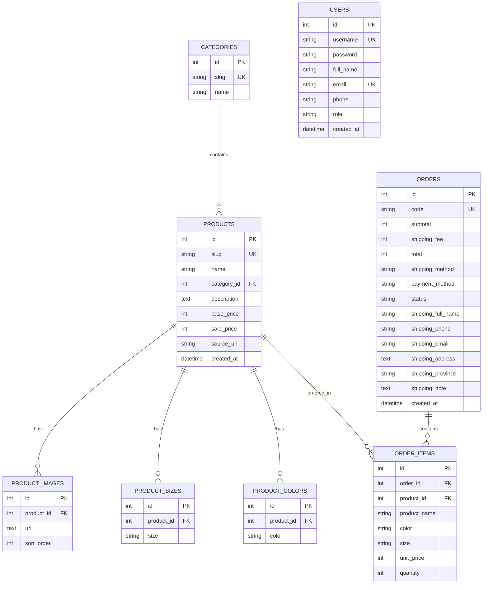

# 🛍️ Henni Shop - E-Commerce Fashion Platform (Minimalist Chic)

[-orange.svg)](#)
[-003B57.svg)](#)
[](#)
[](#)
[](#)

> **Henni Shop** là nền tảng thương mại điện tử thời trang nữ hiện đại theo phong cách **Minimalist Chic**. Dự án được xây dựng với kiến trúc Front-end thuần chuẩn mực kết hợp cùng **Cơ sở dữ liệu quan hệ SQLite Client-side chạy trực tiếp trên trình duyệt thông qua WebAssembly (sql.js)**. Dự án có thể khởi chạy độc lập 100% không cần cài đặt backend hoặc database server phức tạp mà vẫn sở hữu đầy đủ nghiệp vụ thương mại điện tử chuyên nghiệp.

---

## 📑 Mục lục

1. [Giới thiệu tổng quan](#-giới-thiệu-tổng-quan)
2. [Tính năng nổi bật](#-tính-năng-nổi-bật)
3. [Tài khoản đăng nhập & Phân quyền](#-tài-khoản-đăng-nhập--phân-quyền)
4. [Cấu trúc thư mục dự án](#-cấu-trúc-thư-mục-dự-án)
5. [Kiến trúc kỹ thuật & Cơ sở dữ liệu](#-kiến-trúc-kỹ-thuật--cơ-sở-dữ-liệu)
6. [Hướng dẫn cài đặt & Khởi chạy](#-hướng-dẫn-cài-đặt--khởi-chạy)
7. [Quy trình nghiệp vụ chính](#-quy-trình-nghiệp-vụ-chính)
8. [Thông tin liên hệ & Showroom](#-thông-tin-liên-hệ--showroom)

---

## 🌟 Giới thiệu tổng quan

Henni Shop hướng tới trải nghiệm mua sắm tinh tế, thời thượng và mượt mà:
* **Ngôn ngữ thiết kế Minimalist Chic**: Sử dụng bảng màu ấm sang trọng (`#1f1c19`, `#633b2d`, `#c4a07c`, `#faf7f2`), typography kết hợp hoàn hảo giữa font tiêu đề **Playfair Display** cổ điển và font nội dung **Inter** hiện đại.
* **Kiến trúc Zero-Backend Dependency**: Cơ sở dữ liệu SQLite quan hệ được nạp và thực thi trực tiếp bằng WebAssembly trong bộ nhớ trình duyệt, đồng bộ bền vững qua `LocalStorage` / `IndexedDB`.
* **Trải nghiệm Single-Page Feel**: Bộ lọc sản phẩm, tìm kiếm tức thời, giỏ hàng popup, xác thực và quản trị hoạt động tức thì với độ trễ gần như bằng 0.

---

## 🚀 Tính năng nổi bật

### 1. Phía Khách Hàng (Storefront)
* **Trang chủ (`index.html`)**:
  * Banner Hero thời trang phong cách, hiển thị bộ sưu tập mới nhất.
  * Danh mục sản phẩm nổi bật (Áo, Quần, Chân váy, Đầm).
  * Khối sản phẩm bán chạy, sản phẩm mới với tính năng xem nhanh và thêm nhanh vào giỏ.
  * Footer đồng bộ 4 cột chuẩn mực, tích hợp logo và nhận bản tin ưu đãi.
* **Cửa hàng & Danh mục (`san-pham.html`)**:
  * Bộ lọc đa chiều Sidebar: Theo danh mục, khoảng giá, màu sắc và kích thước.
  * Tìm kiếm theo từ khóa tức thì trong tên và mô tả sản phẩm.
  * Sắp xếp linh hoạt: Mới nhất, Giá tăng dần, Giá giảm dần, Tên A-Z.
  * Phân trang động với đếm tổng số sản phẩm tìm thấy.
* **Chi tiết sản phẩm (`chi-tiet.html`)**:
  * Breadcrumb thông minh phân cấp chuẩn: `Trang chủ / Cửa hàng sản phẩm / [Tên sản phẩm]`.
  * Thư viện ảnh sản phẩm sắc nét, phóng to ảnh đại diện khi click thumbnail.
  * Chọn biến thể màu sắc trực quan (swatches) và kích thước (XS, S, M, L, Freesize).
  * Tùy chỉnh số lượng, nút **Thêm vào giỏ hàng** và **Mua ngay**.
  * Gợi ý danh sách sản phẩm liên quan cùng danh mục.
* **Giỏ hàng (`gio-hang.html`)**:
  * **Phân tách giỏ hàng riêng biệt theo từng tài khoản**: Mỗi tài khoản người dùng sở hữu giỏ hàng độc lập hoàn toàn. Khi thêm hàng vào tài khoản này, chuyển sang tài khoản khác giỏ hàng sẽ không bị lẫn lộn, đảm bảo tính riêng tư tuyệt đối cho khách hàng.
  * Bảng giỏ hàng hiển thị hình ảnh, tên, phân loại biến thể, đơn giá và thành tiền.
  * Tăng / giảm số lượng sản phẩm, xóa từng món hoặc làm trống giỏ hàng.
  * Tự động tính phí vận chuyển: **Miễn phí vận chuyển (0₫)** cho đơn hàng từ **800.000₫** trở lên (mặc định 30.000₫ cho đơn dưới 800.000₫).
  * Hỗ trợ áp dụng mã giảm giá Voucher (ví dụ: `HENNI10` giảm 10%).
* **Thanh toán (`thanh-toan.html`)**:
  * Form nhập thông tin nhận hàng chuẩn: Họ tên, Số điện thoại, Email, Tỉnh/Thành phố, Địa chỉ chi tiết, Ghi chú giao hàng.
  * Lựa chọn phương thức vận chuyển: Giao hàng tiêu chuẩn / Giao hàng hỏa tốc.
  * Lựa chọn phương thức thanh toán:
    * **COD**: Thanh toán tiền mặt khi nhận hàng.
    * **Chuyển khoản ngân hàng**: Hiển thị thông tin chuyển khoản VietinBank:
      * **Số tài khoản:** `108876868978`
      * **Ngân hàng:** `VietinBank`
      * **Nội dung chuyển khoản:** Mã đơn hàng tự động sinh dạng `#HN...`
  * Đặt hàng thành công tạo bản ghi vào bảng `orders` và `order_items` trong CSDL SQLite.
* **Tra cứu & Theo dõi đơn hàng (`don-hang.html`)**:
  * Tìm kiếm theo mã đơn hàng hoặc Email / Số điện thoại người nhận.
  * Phân quyền tra cứu thông minh:
    * **Quản trị viên (Admin)**: Xem được danh sách toàn bộ các đơn hàng trong hệ thống.
    * **Khách hàng đã đăng nhập**: Tự động hiển thị toàn bộ lịch sử đơn hàng của tài khoản mình.
    * **Khách vãng lai**: Tra cứu chính xác đơn hàng theo mã đơn.
  * Hiển thị danh sách tóm tắt, nhấn **"Xem chi tiết đơn hàng"** để mở rộng thông tin giao hàng, sản phẩm chi tiết và timeline trạng thái (*Đang xử lý, Đang giao, Đã giao, Đã hủy*).
* **Về chúng tôi (`ve-chung-toi.html`)**:
  * Giới thiệu câu chuyện thương hiệu, triết lý thiết kế và quy trình sản xuất.
  * Thông tin Showroom Flagship TP. HCM tại địa chỉ: **`3 Hòa Bình, Bình Thới, Hồ Chí Minh`**.
  * Nhúng Google Maps vị trí showroom trực tiếp và form liên hệ.
* **Xác thực tài khoản (`dang-nhap.html`, `dang-ky.html`)**:
  * Đăng ký tài khoản mới: Kiểm tra trùng lặp email, kiểm tra độ dài mật khẩu, tự động lưu vào SQLite.
  * Đăng nhập: Phân biệt chính xác chuẩn ký tự chữ hoa/thường của email (ví dụ: `nguyenB@gmail.com` khác `nguyenb@gmail.com`).
  * Tự động điều hướng: Tài khoản Admin được chuyển thẳng về `admin.html`, tài khoản Khách hàng được chuyển về `don-hang.html` hoặc trang trước đó.
  * Khi đăng xuất (`Auth.logout()`): Tự động xóa phiên và chuyển hướng an toàn về trang đăng nhập.

---

### 2. Phía Quản Trị Hệ Thống (`admin.html`)
* **Dashboard Thống kê tổng quan**:
  * 4 Thẻ KPI: Doanh thu thực tế, Tổng số đơn hàng, Tổng sản phẩm trong kho, Số lượng tài khoản khách hàng.
  * Bảng theo dõi các đơn hàng mới nhất với trạng thái xử lý.
* **Quản lý Sản phẩm chuyên sâu**:
  * Danh sách sản phẩm dạng bảng kèm ảnh đại diện, giá bán, giá khuyến mãi, danh mục và slug.
  * Lọc theo danh mục và tìm kiếm sản phẩm theo tên / slug.
  * Modal Thêm / Chỉnh sửa sản phẩm nâng cao:
    * **Bộ chọn Màu sắc dạng Chip đa chọn**: Hiển thị danh sách các màu thời trang chuẩn (Trắng, Đen, Be, Kem, Nâu, Xám, Xanh dương, Xanh navy, Xanh rêu, Xanh lá, Hồng, Đỏ, Vàng, Cam, Tím...) kèm chấm màu swatch và nút `+ Thêm màu` tùy chỉnh.
    * **Bộ chọn Kích thước dạng Pill đa chọn**: Chọn nhanh nhiều size (XS, S, M, L, XL, XXL, Freesize, 26, 27, 28, 29, 30) kèm nút `+ Thêm size`.
    * **Khung Tải lên nhiều hình ảnh (Multi-image Upload)**: Hỗ trợ kéo thả (*Drag & Drop*) hoặc chọn cùng lúc nhiều file ảnh từ máy tính. Ảnh được tự động nén tối ưu qua HTML5 Canvas (max 1000px, 85% JPEG) giúp ảnh sắc nét mà không làm phình CSDL.
    * **Lưới ảnh xem trước (Thumbnails Grid)**: Đánh dấu huy hiệu *Ảnh chính*, nút xóa ảnh nhanh (`✕`) và nút *Đặt làm ảnh chính*.
* **Quản lý Đơn hàng & Danh mục**:
  * Cập nhật trạng thái đơn hàng: *Đang xử lý*, *Đang giao hàng*, *Đã hoàn thành*, *Đã hủy*.
  * Xem danh sách phân loại danh mục.
* **Bảo trì & Khôi phục CSDL**:
  * Nút "Khôi phục CSDL" giúp reset dữ liệu SQLite về trạng thái mẫu ban đầu bất cứ lúc nào.

---

## 👥 Tài khoản đăng nhập & Phân quyền

Hệ thống được tích hợp sẵn 2 tài khoản mẫu trong cơ sở dữ liệu để phục vụ kiểm thử và trải nghiệm:

| Vai trò (Role) | Tên người dùng | Email đăng nhập | Mật khẩu | Quyền hạn & Tính năng |
| :--- | :--- | :--- | :--- | :--- |
| **Quản trị viên (Admin)** | `admin` | `admin@hennishop.vn` | `admin123` | • Truy cập trang Quản trị (`admin.html`)<br>• Thống kê doanh thu, quản lý sản phẩm, danh mục<br>• Xem và đổi trạng thái toàn bộ đơn hàng trong hệ thống |
| **Khách hàng mẫu (Customer)** | `khachhang` | `khachhang@gmail.com` | `123456` | • Mua sắm, thanh toán đơn hàng<br>• Tra cứu lịch sử đơn hàng cá nhân (đơn `#HN261015-8821`)<br>• Quản lý giỏ hàng và thông tin cá nhân |

> **Lưu ý về đăng nhập:** Hệ thống áp dụng quy tắc bảo mật xác thực đúng chuẩn chữ hoa/thường đối với Email (ví dụ: đăng ký `nguyenB@gmail.com` thì đăng nhập bắt buộc phải nhập đúng `nguyenB@gmail.com`).

---

## 📁 Cấu trúc thư mục dự án

```text
d:\Henni_Shop/
│
├── index.html                   # Trang chủ chính của Henni Shop
├── san-pham.html                # Trang Cửa hàng / Danh mục sản phẩm (kèm bộ lọc)
├── chi-tiet.html                # Trang Chi tiết sản phẩm & Chọn biến thể
├── gio-hang.html                # Trang Giỏ hàng & Áp dụng Voucher
├── thanh-toan.html              # Trang Thanh toán & Lựa chọn phương thức thanh toán
├── don-hang.html                # Trang Tra cứu & Theo dõi đơn hàng
├── ve-chung-toi.html            # Trang Giới thiệu thương hiệu & Showroom
├── dang-nhap.html               # Trang Đăng nhập hệ thống
├── dang-ky.html                 # Trang Đăng ký tài khoản mới
├── admin.html                   # Trang Bảng điều khiển Quản trị viên (Admin Dashboard)
├── README.md                    # Tài liệu hướng dẫn & Giới thiệu dự án
│
├── css/                         # Thư mục mã nguồn CSS module hóa
│   ├── base.css                 # CSS biến toàn cục, typography, reset, grid
│   ├── components.css           # Các thành phần tái sử dụng (Button, Badge, Card, Modal, Toast)
│   ├── pages.css                # Style chuyên biệt cho từng trang & Admin Dashboard
│   └── responsive.css           # Quy tắc Responsive cho thiết bị di động và tablet
│
├── js/                          # Thư mục mã nguồn JavaScript ES6+
│   ├── database.js              # Khởi tạo WebAssembly SQLite (sql.js) & Quản lý Schema
│   ├── app.js                   # Logic ứng dụng dùng chung: Auth, Cart, Toast, Header, Search
│   ├── home.js                  # Logic kết xuất dữ liệu Trang chủ
│   ├── catalog.js               # Logic lọc đa chiều, tìm kiếm & phân trang sản phẩm
│   ├── detail.js                # Logic trang Chi tiết sản phẩm, chọn màu, chọn size
│   ├── cart.js                  # Logic hiển thị và tính toán Giỏ hàng
│   ├── checkout.js              # Logic form Thanh toán, đặt hàng vào CSDL
│   ├── order-tracking.js        # Logic tra cứu và hiển thị chi tiết đơn hàng
│   └── admin.js                 # Logic Quản trị: Thống kê, CRUD sản phẩm, upload ảnh
│
├── data/                        # Thư mục chứa dữ liệu CSDL SQLite
│   ├── schema.sql               # Script DDL/DML khởi tạo cấu trúc bảng và seed data
│   └── hennishop.db             # File CSDL nhị phân SQLite (chuẩn SQLite 3)
│
└── images/                      # Thư mục hình ảnh & tài nguyên đồ họa
    ├── logo.png                 # Logo chính thức thương hiệu Henni Shop
    └── [product-folders]/       # Thư mục ảnh sản phẩm phân theo từng mã danh mục
```

---

## 🗄️ Kiến trúc kỹ thuật & Cơ sở dữ liệu

### 1. Kiến trúc Client-Side SQLite via WebAssembly
* Ứng dụng tích hợp thư viện **`sql.js`** (`sql-wasm.js` + `sql-wasm.wasm`).
* Khi trang web tải, `database.js` khởi tạo WebAssembly Engine trong trình duyệt.
* Toàn bộ các thao tác SQL (`SELECT`, `INSERT`, `UPDATE`, `DELETE`, `JOIN`, `GROUP BY`) được thực thi cục bộ với tốc độ cao.
* CSDL được lưu trữ bền bỉ vào `localStorage` dạng nhị phân base64, giúp duy trì dữ liệu khi người dùng chuyển trang hoặc tải lại trình duyệt.
* Tích hợp cơ chế **Fallback Schema**: Nếu trình duyệt chặn tải file `.wasm` cục bộ do chính sách CORS của giao thức `file:///`, hệ thống sẽ tự động chuyển sang schema dự phòng để đảm bảo 100% ứng dụng luôn vận hành mượt mà.

### 2. Sơ đồ các bảng trong Cơ sở dữ liệu



---

## 💻 Hướng dẫn cài đặt & Khởi chạy

Vì dự án chạy hoàn toàn trên Front-end với WebAssembly, bạn có thể khởi chạy bằng bất kỳ công cụ Static Server nào. Khuyến nghị sử dụng một Local HTTP Server để trình duyệt nạp tài nguyên WebAssembly thuận lợi nhất:

### Cách 1: Sử dụng Visual Studio Code (Khuyến nghị)
1. Mở thư mục `d:\Henni_Shop` bằng **Visual Studio Code**.
2. Cài đặt extension **Live Server** (của Ritwick Dey).
3. Nhấp chuột phải vào file [`index.html`](file:///d:/Henni_Shop/index.html) và chọn **"Open with Live Server"**.
4. Website sẽ tự động mở tại địa chỉ `http://127.0.0.1:5500/index.html`.

### Cách 2: Sử dụng Python
Nếu máy tính của bạn đã có cài sẵn Python:
```bash
# Di chuyển vào thư mục dự án
cd d:\Henni_Shop

# Khởi chạy máy chủ HTTP (Python 3)
python -m http.server 8000
```
Truy cập trình duyệt tại địa chỉ: `http://localhost:8000`

### Cách 3: Sử dụng Node.js (npx serve / http-server)
```bash
# Di chuyển vào thư mục dự án
cd d:\Henni_Shop

# Chạy với npx serve
npx serve .
# Hoặc với http-server
npx http-server -p 8080
```
Truy cập địa chỉ hiển thị trên terminal (ví dụ `http://localhost:8080`).

---

## 🔄 Quy trình nghiệp vụ chính

### 1. Luồng mua hàng của Khách hàng:
```
Trang chủ (index.html)
   └── Cửa hàng (san-pham.html) [Lọc & Tìm kiếm]
        └── Chi tiết sản phẩm (chi-tiet.html) [Chọn Màu & Size]
             └── Giỏ hàng (gio-hang.html) [Cập nhật SL & Nhập Voucher]
                  └── Thanh toán (thanh-toan.html) [Nhập thông tin & Chọn COD/Chuyển khoản]
                       └── Đặt hàng thành công ➔ Chuyển hướng Tra cứu đơn hàng (don-hang.html)
```

### 2. Luồng Quản trị của Admin:
```
Đăng nhập (dang-nhap.html) [Tài khoản Admin]
   └── Bảng điều khiển Quản trị (admin.html)
        ├── Xem số liệu KPI Doanh thu, Đơn hàng, Khách hàng
        ├── Quản lý Sản phẩm:
        │    ├── Thêm mới sản phẩm (Chọn nhiều chip màu, pill size, upload kéo thả nhiều ảnh)
        │    ├── Chỉnh sửa thông tin, giá bán, biến thể
        │    └── Xóa sản phẩm
        ├── Quản lý Đơn hàng: Cập nhật trạng thái giao nhận
        └── Khôi phục dữ liệu mẫu ban đầu khi cần thiết
```

---

## 📍 Thông tin liên hệ & Showroom

* **Thương hiệu:** Henni Shop - Thời trang nữ Minimalist Chic
* **Showroom Flagship TP. HCM:** `3 Hòa Bình, Bình Thới, Hồ Chí Minh`
* **Hotline hỗ trợ:** `0988.123.456`
* **Email chính thức:** `contact@hennishop.vn`
* **Tài khoản thụ hưởng chuyển khoản:**
  * **Ngân hàng:** VietinBank
  * **Số tài khoản:** `108876868978`
  * **Chủ tài khoản:** CÔNG TY TNHH HENNI SHOP

---

## 📄 Bản quyền & Đóng góp
Dự án được xây dựng và phát triển phục vụ học tập, nghiên cứu và triển khai ứng dụng thương mại điện tử Front-end hiện đại với SQLite Client-side WebAssembly. Mọi quyền được bảo lưu © 2026 Henni Shop.
